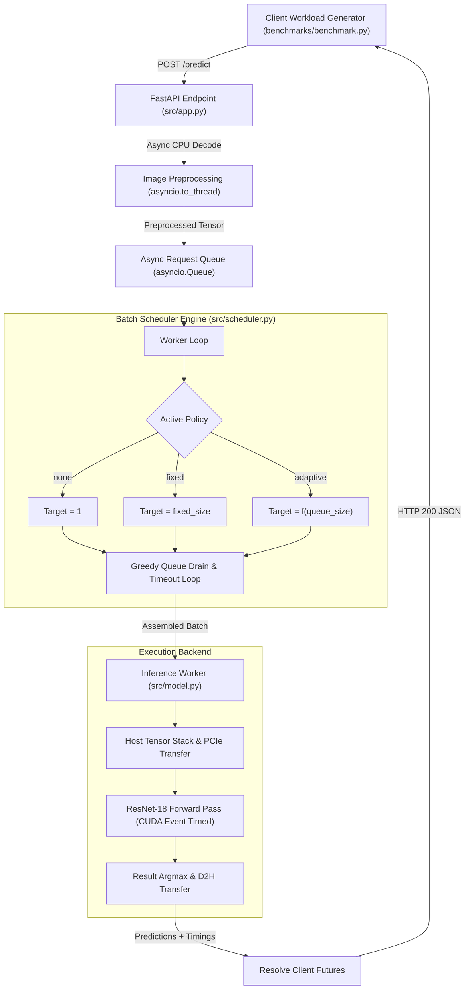

# Dynamic Batching-Based High-Throughput Image Inference Server

An asynchronous, GPU-accelerated deep learning inference server designed to maximize throughput and optimize GPU resource utilization using dynamic request batching.

> **Academic Disclaimer**: This software is an experimental prototype developed as an undergraduate academic study for *Deep Learning with Accelerated Computing*. It demonstrates the empirical trade-offs between batching delay, queue latency, and GPU throughput. It is not presented as an established publication-ready novel scheduling architecture. Realized performance metrics depend heavily on the target hardware, Total Graphics Power (TGP) constraints, PyTorch/CUDA versions, and workload arrival patterns.

---

## 1. Project Overview & Problem Statement

Deploying deep learning vision backbones in interactive environments presents a fundamental tension between **latency** and **throughput**:
- **Sequential Execution (`batch_size=1`)**: Provides low latency for isolated requests but severely underutilizes modern GPU tensor cores, resulting in poor saturated throughput.
- **Static Large Batching**: Saturates GPU compute units efficiently but introduces unacceptable queuing delays for early-arriving requests during sparse traffic.

This project implements an asynchronous serving architecture in Python, FastAPI, and PyTorch that buffers incoming inference requests in an asynchronous queue and evaluates three batch scheduling policies:
1. **`none` (Sequential)**: Processes requests one by one.
2. **`fixed` (Static Dynamic Batching)**: Accumulates requests up to a static batch size or until a maximum waiting time expires.
3. **`adaptive` (Queue-Pressure Dynamic Batching)**: Dynamically scales batch targets based on instantaneous queue pressure to balance latency at low loads and throughput at high loads.

---

## 2. Objectives and Scope

- **Asynchronous Front-End**: Ingest concurrent HTTP multipart image requests without blocking the inference engine.
- **Dynamic Batch Aggregation**: Implement queue-draining algorithms that group requests into batches without starving waiting requests.
- **Accurate Profiling**: Dissect end-to-end client latency into HTTP/preprocessing delay, server queue waiting time, and device-side CUDA kernel execution time.
- **Hardware Benchmarking**: Benchmark comparative performance on laptop GPUs (such as the NVIDIA RTX 4060 Laptop GPU and RTX 5060 Laptop GPU) across a sweep of concurrency levels.

---

## 3. Architecture & Request Workflow



---

## 4. Repository Structure

```text
dynamic-batching-image-inference-server/
├── README.md                           # Comprehensive project documentation
├── pyproject.toml                      # Project build metadata and dependencies
├── requirements.txt                    # Pinned Python package dependencies
├── configs/
│   └── example.yaml                    # Non-machine-specific example server configuration
├── src/
│   ├── __init__.py
│   ├── app.py                          # FastAPI service, endpoints, and lifespan management
│   ├── model.py                        # ResNet-18 model wrapper, transform, and CUDA timing
│   └── scheduler.py                    # Async queue manager and batch aggregation engine
├── tests/
│   ├── test_api.py                     # API endpoint correctness tests
│   ├── test_model.py                   # Model initialization and inference tests
│   └── test_scheduler.py               # Batch scheduling policy and backlog tests
├── benchmarks/
│   ├── README.md                       # Benchmark execution and metric documentation
│   ├── make_test_image.py              # Synthetic JPEG generator
│   ├── benchmark.py                    # Concurrency-controlled asynchronous client
│   ├── run_matrix.py                   # Concurrency sweep automation runner
│   ├── monitor_gpu.py                  # Background NVIDIA-SMI telemetry logger
│   ├── system_info.py                  # Hardware, driver, and CUDA diagnostic collector
│   └── analyze.py                      # Result aggregation and chart generator
├── docs/
│   ├── architecture.md                 # Detailed architectural and concurrency specification
│   ├── methodology.md                  # Measurement boundaries and benchmarking protocol
│   ├── limitations.md                  # Known caveats, constraints, and future work
│   ├── DLAC Project Abstract.docx      # Academic course abstract
│   └── experiment_log_template.csv     # Manual laboratory notebook template
└── results/
    ├── README.md                       # Output reproduction instructions
    └── .gitkeep
```

---

## 5. Requirements and Setup

### Prerequisites
- **Operating System**: Windows 10/11 or Linux
- **Python**: Version 3.11 recommended
- **Hardware**: NVIDIA GPU with CUDA driver support (or CPU for testing)

### Installation

1. **Clone the repository**:
   ```bash
   git clone https://github.com/SujitVakkalanka1/DLAC-Project-.git
   cd DLAC-Project-
   ```

2. **Create and activate a virtual environment**:
   ```powershell
   py -3.11 -m venv .venv
   .\.venv\Scripts\Activate.ps1
   python -m pip install --upgrade pip
   ```

3. **Install PyTorch with CUDA support**:
   Select the appropriate CUDA build matching your local NVIDIA driver (e.g., CUDA 12.8):
   ```powershell
   pip install torch torchvision --index-url https://download.pytorch.org/whl/cu128
   ```

4. **Install project dependencies**:
   ```powershell
   pip install -r requirements.txt
   ```

5. **Verify GPU detection and generate synthetic test image**:
   ```powershell
   python -c "import torch; print('CUDA Available:', torch.cuda.is_available(), '| GPU:', torch.cuda.get_device_name(0) if torch.cuda.is_available() else 'None')"
   python benchmarks/make_test_image.py
   python benchmarks/system_info.py
   ```

---

## 6. Running the Server

The server can be configured via environment variables or a YAML configuration file (`configs/example.yaml`).

### Running with Environment Variables
```powershell
$env:BATCH_MODE="adaptive"       # none, fixed, or adaptive
$env:FIXED_BATCH_SIZE="8"        # Target size for fixed mode
$env:MAX_BATCH_SIZE="16"         # Max batch capacity
$env:MAX_WAIT_MS="20"            # Batch accumulation delay in ms
uvicorn src.app:app --host 127.0.0.1 --port 8000 --workers 1
```

### Running with YAML Configuration
```powershell
$env:CONFIG_PATH="configs/example.yaml"
uvicorn src.app:app --host 127.0.0.1 --port 8000 --workers 1
```

---

## 7. Running Automated Tests

Run the complete regression and correctness test suite:
```powershell
python -m unittest discover tests
```

The test suite covers:
- **`tests/test_scheduler.py`**: Verifies that `none` mode maintains batch size 1, `fixed` mode aggregates requests to `fixed_size`, `adaptive` mode scales with queue depth, backlogs are greedily drained, timeouts dispatch partial batches, and server shutdown is clean.
- **`tests/test_model.py`**: Validates model initialization, transforms, preprocessing shape `(3, 224, 224)`, and batched forward pass output structures.
- **`tests/test_api.py`**: Tests FastAPI health and stats endpoints, image classification with valid inputs, invalid image rejection (`400`), and oversized file handling (`413`).

---

## 8. API Usage & Example Endpoints

### `GET /health`
Returns the operational health and currently active batching policy.
```bash
curl http://127.0.0.1:8000/health
```
**Response**:
```json
{
  "status": "ok",
  "mode": "adaptive",
  "device": "cuda:0"
}
```

### `GET /stats`
Returns live scheduler telemetry and batch size distribution histogram.
```bash
curl http://127.0.0.1:8000/stats
```
**Response**:
```json
{
  "mode": "adaptive",
  "processed": 128,
  "batches": 16,
  "batch_histogram": { "8": 16 },
  "queued": 0
}
```

### `POST /predict`
Upload an image via multipart/form-data for classification.
```bash
curl -X POST -F "file=@test_images/synthetic.jpg" http://127.0.0.1:8000/predict
```
**Response**:
```json
{
  "class_id": 107,
  "label": "jellyfish",
  "batch_size": 8,
  "queue_ms": 2.145,
  "gpu_batch_ms": 5.482,
  "server_batch_ms": 7.120
}
```

---

## 9. Benchmarking Workflow

For multi-terminal benchmarking:

1. **Terminal 1**: Start the server with the target mode (e.g. `fixed` or `adaptive`).
2. **Terminal 2**: Start background GPU telemetry logging:
   ```powershell
   python benchmarks/monitor_gpu.py --out results/4060_adaptive_gpu.csv
   ```
3. **Terminal 3**: Execute the automated concurrency sweep across levels 1, 4, 16, 32:
   ```powershell
   python benchmarks/run_matrix.py --system 4060 --repeats 3 --requests 300
   ```
4. **Aggregate Results and Generate Charts**:
   ```powershell
   python benchmarks/analyze.py
   ```
   Outputs will be stored in `results/comparison_summary.csv`, `results/comparison_throughput_mean.png`, and `results/comparison_p95_latency_mean.png`.

---

## 10. Limitations & Known Issues

- **Closed-Loop Concurrency**: Benchmark clients issue requests as preceding ones finish. Real production traffic is open-loop (e.g., Poisson arrivals), which can generate heavier tail queuing.
- **Model Size**: ResNet-18 has a very low inference latency (~2.4 ms on RTX 4060). Consequently, system latency is dominated by HTTP/CPU framing rather than GPU kernel saturation.
- **Laptop TGP Variability**: Comparing laptop GPUs across chassis involves uncontrolled thermal dissipation and OEM-configured power limits (TGP), which must be tracked via `system_info.py`.
- **Synthetic Image Label**: The label produced from `test_images/synthetic.jpg` is an artifact of random noise passing through ImageNet weights and does not reflect model accuracy.

See [docs/limitations.md](docs/limitations.md) and [docs/methodology.md](docs/methodology.md) for detailed scientific discussions.
