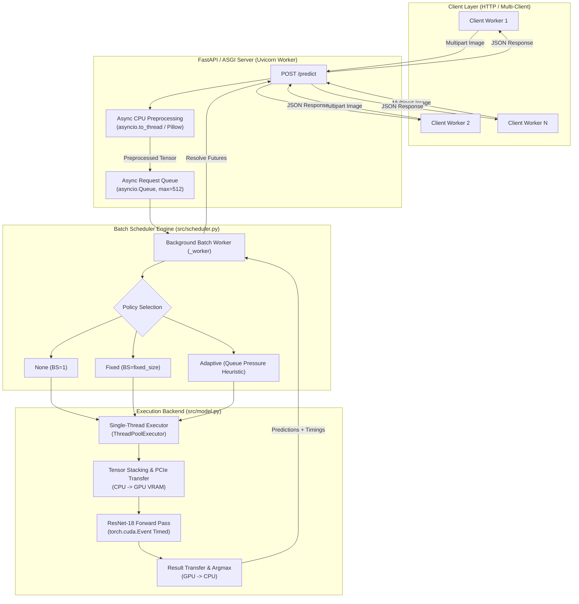

# System Architecture & Request Lifecycle

This document describes the architectural design, concurrency model, and execution flow of the **Dynamic Batching-Based High-Throughput Image Inference Server**.

## 1. High-Level Architecture Overview

The system is designed as an asynchronous, single-worker GPU inference server that bridges an asynchronous HTTP front-end (FastAPI / ASGI) with a synchronous, batched deep learning forward pass (PyTorch / CUDA).

---

## 2. Request Lifecycle & Concurrency Pipeline

1. **HTTP Ingestion**:
   - Incoming image requests are received by the `/predict` FastAPI endpoint.
   - Content length is verified against the configurable size limit (default 10 MB). Oversized payloads immediately return `413 Payload Too Large`.

2. **Asynchronous Preprocessing**:
   - Image decompression (Pillow) and canonical ResNet transformations (resize to 256, center-crop to 224, float normalization) are executed via `asyncio.to_thread` in Python's thread pool.
   - This prevents blocking the main asyncio event loop during CPU-intensive image decoding.
   - If an uploaded file cannot be parsed as a valid image, a `400 Bad Request` is returned.

3. **Queue Ingestion**:
   - A preprocessed tensor is packaged with an `asyncio.Future` and a high-resolution timestamp (`time.perf_counter()`).
   - The request is placed into `asyncio.Queue` via `put_nowait()`.
   - If the queue is at capacity (`max_queue=512`), `asyncio.QueueFull` is caught and returned as `503 Service Unavailable`.

4. **Batch Formation**:
   - The dedicated scheduler worker (`_worker`) dequeues the first waiting request.
   - Based on the configured policy (`none`, `fixed`, `adaptive`), a target batch size is computed.
   - The worker greedily drains all already-available requests from the queue up to `target`.
   - If the batch has not yet reached `target` and the policy is `fixed` or `adaptive`, the worker waits up to `max_wait_ms` for new arrivals before timing out.

5. **GPU Inference**:
   - The gathered batch of tensors is dispatched to `ThreadPoolExecutor(max_workers=1)`. A single execution thread ensures serialized access to the CUDA device without race conditions or CUDA context thrashing.
   - Tensors are stacked into a 4D batch tensor `(B, 3, 224, 224)` and transferred to `cuda:0`.
   - Forward pass timing is measured on device using `torch.cuda.Event(enable_timing=True)`.
   - Classification labels are computed via `.argmax(dim=1).cpu().tolist()`.

6. **Response Dispatch**:
   - Futures are resolved with predictions, observed batch size, queue latency (`queue_ms`), GPU kernel latency (`gpu_batch_ms`), and server wall-clock batch time (`server_batch_ms`).
   - The HTTP response is returned to the awaiting client coroutine.

---

## 3. Threading and Device Synchronization

| Operation | Execution Context | Mechanism |
| :--- | :--- | :--- |
| Event Loop & Queue Management | Main Thread | `asyncio` event loop |
| Image Decoding & Transforms | Default Async Thread Pool | `asyncio.to_thread` |
| GPU Stacking & Inference | Inference Worker Thread | `ThreadPoolExecutor(max_workers=1)` |
| GPU Kernel Timing | NVIDIA CUDA Hardware | `torch.cuda.Event` & `torch.cuda.synchronize()` |
